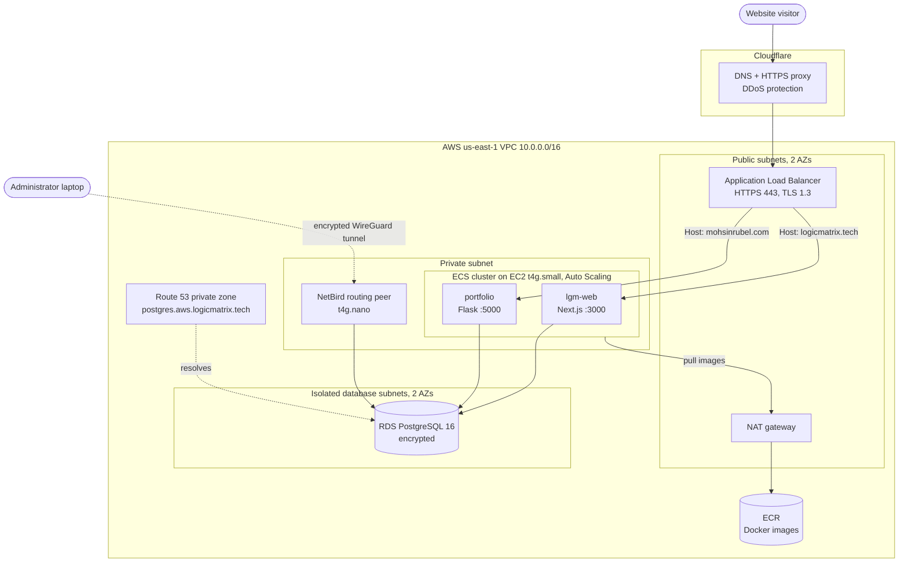

# Production AWS Infrastructure with Terraform

> Two containerized web applications running on AWS, described entirely as code.
> One `terraform apply` builds the network, load balancer, TLS certificate,
> container cluster, PostgreSQL database, private DNS and a secure admin VPN path.


---

## Table of contents

1. [What this project is](#what-this-project-is)
2. [New to Terraform? Start here](#new-to-terraform-start-here)
3. [Architecture](#architecture)
4. [What gets built](#what-gets-built)
5. [Project structure](#project-structure)
6. [Design decisions and highlights](#design-decisions-and-highlights)
7. [How to deploy it](#how-to-deploy-it)
8. [Adding a new website](#adding-a-new-website)
9. [Outputs](#outputs)
10. [Further reading](#further-reading)
11. [What I learned](#what-i-learned)

---

## What this project is

I built this as the production infrastructure for my company. It hosts two applications:

| Application | Stack | Purpose |
|---|---|---|
| `lgm-web` | Next.js (Node.js) | The company website |
| `portfolio` | Flask (Python) | A personal portfolio site |

Both apps run as Docker containers on **Amazon ECS**. They sit behind one shared
**HTTPS load balancer** and use one shared **PostgreSQL** database. **Cloudflare**
handles public DNS and DDoS protection in front of everything.

None of this was set up by clicking around the AWS console. Every server,
network, firewall rule and certificate is defined in the `.tf` files in this
repository.

---

## New to Terraform? Start here

**Terraform** is a tool for *Infrastructure as Code (IaC)*. You describe the
infrastructure you want in text files, and Terraform makes the cloud match them.

Think of it like an architect's blueprint. You don't lay each brick yourself.
You hand over a drawing, and the builder (Terraform) works out what to build,
change or tear down so reality matches the drawing.

### The five ideas you need

| Concept | What it means | Example in this repo |
|---|---|---|
| **Provider** | A plugin that lets Terraform talk to a platform such as AWS. | [provider.tf](provider.tf) |
| **Resource** | A single piece of infrastructure: a server, a firewall rule, a database. | `aws_db_instance.postgres` in [database.tf](database.tf) |
| **Variable** | An input value, so the same code works with different settings. | `db_instance_type` in [variables.tf](variables.tf) |
| **Module** | A reusable bundle of resources, like a function in programming. | [modules/vpc/](modules/vpc/) builds the whole network |
| **State** | Terraform's record of what it has already created. It is stored in S3 so a team can share it. | [backend_bootstrap/](backend_bootstrap/) |

### The workflow

```bash
terraform init      # Download the providers and connect to remote state
terraform plan      # Preview: show what WOULD change, without changing anything
terraform apply     # Make the changes for real (asks for confirmation)
terraform destroy   # Tear everything down
```

`plan` is the safety net. You always see exactly what will be created, changed
or deleted before anything happens.

### A tiny example

This block, taken from [database.tf](database.tf) and shortened, is all it takes
to get an encrypted, private, backed-up PostgreSQL server:

```hcl
resource "aws_db_instance" "postgres" {
  engine              = "postgres"
  instance_class      = "db.t4g.micro"   # small, low-cost ARM instance
  storage_encrypted   = true             # data encrypted at rest
  publicly_accessible = false            # no internet access, ever
  deletion_protection = true             # can't be deleted by accident
  backup_retention_period = 7            # keep 7 days of automatic backups
}
```

---

## Architecture



### How a request flows

1. A visitor opens `https://logicmatrix.tech`.
2. **Cloudflare** answers the DNS lookup, terminates HTTPS at its edge and filters
   malicious traffic.
3. Cloudflare forwards the request over a second HTTPS connection to the **AWS
   load balancer**. It checks the AWS certificate first ("Full (strict)" mode),
   so traffic is encrypted end to end.
4. The load balancer reads the `Host` header and picks the right app. Each
   domain has its own routing rule and target group.
5. The **ECS container** handles the request and reads data from **PostgreSQL**
   through a private network path. The database has no public address.

### How an administrator reaches the database

The database cannot be reached from the internet at all. To run migrations or
queries, an administrator connects through **NetBird** (a WireGuard-based VPN).
A tiny `t4g.nano` instance inside the VPC acts as the gateway. It has **no
inbound ports open**, and if NetBird fails, **AWS SSM Session Manager** is the
backup way in.

---

## What gets built

| Layer | AWS resources | Why |
|---|---|---|
| **Network** | VPC, 2 public + 1 private + 2 database subnets, Internet gateway, NAT gateway, S3 gateway endpoint | Separates internet-facing, application and data tiers |
| **Traffic** | Application Load Balancer, one target group per app, host-based listener rules | One load balancer serves many domains |
| **TLS** | ACM certificate covering every configured domain | Free, auto-renewing HTTPS certificates |
| **Compute** | ECS cluster, EC2 launch template, Auto Scaling Group, capacity provider | Runs the containers and scales the EC2 fleet automatically |
| **Applications** | Task definitions, ECS services, IAM execution roles, CloudWatch log groups | One self-contained module per app |
| **Images** | Two ECR repositories with lifecycle policies | Private Docker registry; old images are cleaned up |
| **Database** | RDS PostgreSQL 16, subnet group, security group | Encrypted, private, backed up, protected from deletion |
| **Private DNS** | Route 53 private hosted zone, `postgres.*` CNAME | Stable internal hostname instead of a long RDS endpoint |
| **Admin access** | NetBird EC2 peer, encrypted SSM parameter for its setup key, IAM role | Zero-trust database access with no public ports |
| **State** | S3 bucket with versioning, encryption and native locking | Shared, recoverable Terraform state |

---

## Project structure

```text
.
├── backend_bootstrap/        # Run once: creates the S3 bucket that stores Terraform state
├── modules/                  # Reusable building blocks
│   ├── vpc/                  #   Network: subnets, routing, NAT, S3 endpoint
│   ├── alb/                  #   Load balancer, target groups, host-based routing
│   ├── acm/                  #   TLS certificate request
│   ├── ecr/                  #   Docker image repository
│   ├── ecs/                  #   Cluster, EC2 Auto Scaling Group, capacity provider
│   └── app/
│       ├── lgm-web/          #   Next.js service + task definition
│       └── portfolio/        #   Flask service + task definition
├── main.tf                   # Wires the modules together for lgm-web
├── portfolio.tf              # Wires the modules together for the portfolio app
├── database.tf               # RDS PostgreSQL and its firewall rules
├── private-dns.tf            # Route 53 private zone
├── netbird-routing-peer.tf   # VPN gateway for admin database access
├── templates/                # cloud-init script for the NetBird instance
├── variables.tf              # Every configurable input, with validation
├── outputs.tf                # Values printed after apply (ALB DNS name, DB address, ...)
├── provider.tf               # AWS provider and S3 remote-state backend
├── tags.tf                   # Tags applied to every resource
├── docs/                     # Detailed runbooks (Cloudflare, PostgreSQL, NetBird, DNS)
├── .github/workflows/        # GitHub Actions automation
└── .devcontainer/            # Ready-made dev environment (Terraform + AWS CLI)
```

---

## Design decisions and highlights

**Security**
- **Defense in depth.** Internet → Cloudflare → load balancer → private
  containers → isolated database. Each tier only accepts traffic from the tier
  directly in front of it, enforced by security group references rather than
  IP ranges.
- **No public database, no SSH.** RDS has `publicly_accessible = false` and the
  database subnets have no route to the internet. Admin access goes through
  NetBird, with SSM as a fallback, so there are no SSH keys to manage.
- **Encryption everywhere.** TLS 1.3 policy on the load balancer, Cloudflare
  Full (strict) mode, encrypted RDS storage, encrypted EBS volumes, encrypted
  S3 state.
- **Secrets stay out of user data.** The NetBird setup key is stored as an
  encrypted SSM `SecureString`. The instance's boot script only contains the
  parameter *name* and fetches the value at runtime.
- **A GitHub Actions workflow** fetches Cloudflare's published IP ranges and
  syncs them into the load balancer's security group allow-list.

**Reliability and safety**
- **Input validation.** Variables reject bad values before anything is
  deployed: a malformed domain, a duplicate domain across services, an invalid
  port, an empty secret.
- **`check` blocks** confirm that each app's container port matches its load
  balancer target group.
- **Deletion protection** on the database, a final snapshot on destroy, and
  `prevent_destroy` on the state bucket.
- **Remote state** in S3 with versioning and native S3 locking (no DynamoDB
  table needed).

**Cost awareness**
- **ARM64 Graviton instances** (`t4g.small` for ECS, `t4g.nano` for the VPN,
  `db.t4g.micro` for RDS) cost less than the x86 equivalents.
- **One load balancer and one certificate** shared by every website instead of
  one per site.
- **An S3 gateway endpoint** keeps ECR image-layer downloads off the paid NAT
  gateway.

**Maintainability**
- **Data-driven routing.** Adding a website is a few lines in a variable map.
  Terraform uses `for_each` to create the target group, listener rules and
  certificate names.
- **One module per app**, so each service can be changed, scaled or removed
  independently.
- **Consistent tagging** (`Environment`, `Project`, `ManagedBy`, `Team`) on
  every resource through provider `default_tags`.

---

## How to deploy it

### Prerequisites

- Terraform **1.10 or later**
- AWS CLI, configured with credentials for the target account
- A Cloudflare account that hosts your domains
- *Optional:* open the repo in VS Code with the included **Dev Container** and
  every tool is pre-installed.

### Step 1: Create the state bucket (one time only)

Terraform needs somewhere to store its state. This small stack creates that S3 bucket:

```bash
cd backend_bootstrap
terraform init
terraform apply
cd ..
```

### Step 2: Provide your settings

Create a `terraform.tfvars` file. It is listed in `.gitignore` and must **never**
be committed, because it holds passwords.

```hcl
service_routes = {
  lgm-web = {
    domains           = ["example.com", "www.example.com"]
    target_group_port = 3000
    health_check_path = "/"
  }
  portfolio = {
    domains           = ["portfolio.example.com"]
    target_group_port = 5000
    health_check_path = "/"
  }
}

db_password                    = "change-me"
netbird_routing_peer_setup_key = "change-me"
# ...plus the application secrets listed in variables.tf
```

You can also pass any variable as an environment variable, for example
`TF_VAR_db_password`.

### Step 3: Request the TLS certificate

AWS must prove you own the domains before it issues a certificate, so this step
comes first:

```bash
terraform init
terraform apply -target=module.acm.aws_acm_certificate.wildcard
terraform output -json acm_domain_validation_records
```

Add each returned record to Cloudflare as a **CNAME** with the proxy **off**
(grey cloud). Keep these records; ACM uses them to renew the certificate
automatically.

### Step 4: Build everything else

```bash
terraform plan    # review what will be created
terraform apply
terraform output alb_dns_name
```

### Step 5: Point Cloudflare at AWS

For each domain, create a **proxied** (orange cloud) CNAME record pointing to
the `alb_dns_name` output. Then set **SSL/TLS → Full (strict)** and enable
**Always Use HTTPS**.

The step-by-step guide with troubleshooting is in
[docs/cloudflare-manual-setup.md](docs/cloudflare-manual-setup.md).

---

## Adding a new website

This is where the data-driven design pays off. To host a third site:

1. Add an entry to `service_routes`:

   ```hcl
   blog = {
     domains           = ["blog.example.com"]
     target_group_port = 8080
     health_check_path = "/health"
   }
   ```

2. Copy one of the folders in [modules/app/](modules/app/) and point its
   `alb_target_group_arn` at `module.alb.target_group_arns["blog"]`.
3. Run `terraform apply`.

Terraform creates the new target group and routing rule and adds the domain to
the certificate. The existing sites are not affected.

---

## Outputs

After `apply`, Terraform prints the values you need for the next steps:

| Output | Used for |
|---|---|
| `alb_dns_name` | Target of the Cloudflare CNAME records |
| `acm_domain_validation_records` | DNS records that prove domain ownership |
| `ecr_repository_url` | Where CI/CD pushes Docker images |
| `database_address`, `database_port` | Private database connection details |
| `target_group_arns` | Connecting new ECS services to the load balancer |
| `netbird_routing_peer_instance_id` | SSM fallback access to the VPN gateway |
| `private_hosted_zone_id` | Adding more internal DNS records |

The full list is in [outputs.tf](outputs.tf).

---

## Further reading

Detailed runbooks for each part of the system:

- [Cloudflare setup](docs/cloudflare-manual-setup.md): DNS, TLS modes, multi-domain routing, troubleshooting
- [PostgreSQL](docs/postgresql.md): network placement, access, backups, deletion safeguards
- [NetBird routing peer](docs/netbird-routing-peer.md): VPN setup, key rotation, client access
- [Private DNS](docs/private-dns.md): internal Route 53 zone and record examples

---

## What I learned

- Designing a **multi-tier VPC** where each layer only trusts the layer in front of it
- **Host-based routing** to serve many domains from one load balancer and one certificate
- Running **ECS on EC2 with capacity providers**, so the cluster scales its own instances
- Building **zero-trust admin access** to a private database without bastion hosts or SSH keys
- Writing **reusable, validated Terraform modules** that catch mistakes at `plan` time
- Handling the **chicken-and-egg problems** of infrastructure: the state bucket
  before the state, and the certificate before the HTTPS listener
- Balancing **security, reliability and cost** for a real production workload

---

<p align="center">
  Built with Terraform. Feel free to open an issue or reach out with questions.
</p>
